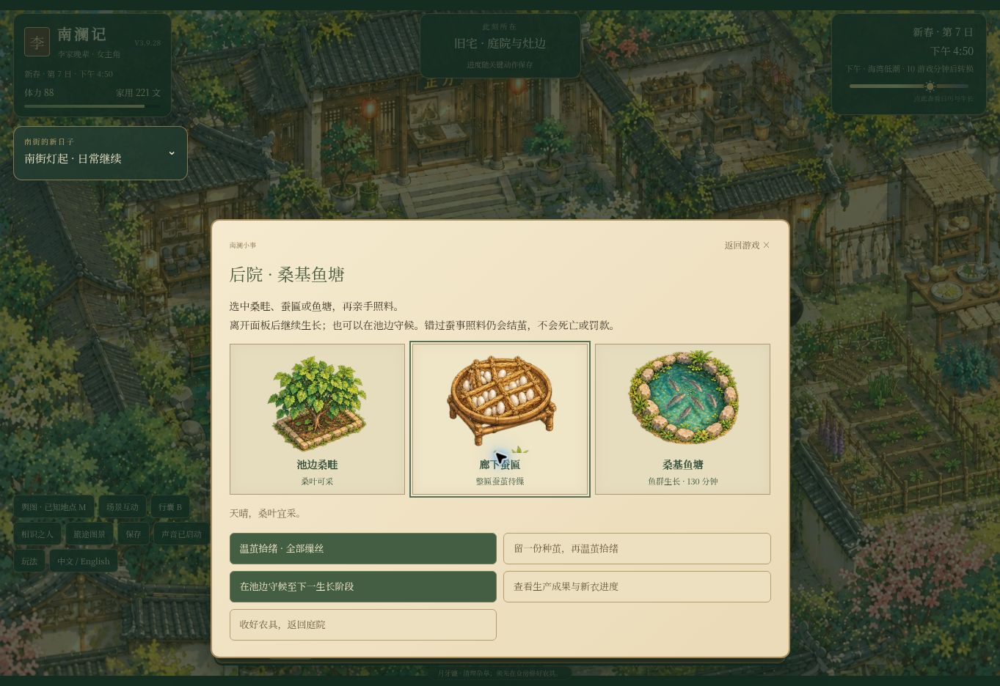

# V3.9.28 · 桑塘乡约

- 第一卷新增三桩可选乡约。菜篮、鲜草与竹材有独立预留，已承诺的货不能二次交付。日后由村民面授种子交换、晒药图与竹林路径。
- 第二卷后院新增湿叶、清匾、蚕沙喂鱼、塘泥培桑、暴雨护塘、主动留种，以及八秒抽丝。已有存档和正在生长的旧批次均可继续。
- 南街新增实货丝样单、三日交期与丝样柜。自产货带着成本装箱，按实际运费入库，成交后才计收入与成本。
- 存档键与版本号保持不变。新增状态在读取旧档时补齐；不会要求玩家重开或重签租约。
- 第一卷与第二卷剧情回归，养殖与乡约测试分别见游戏源码中的 engine.test.cjs、volume2.test.cjs、production.test.cjs、rural.test.cjs。网页发行版使用根目录相对路径。

